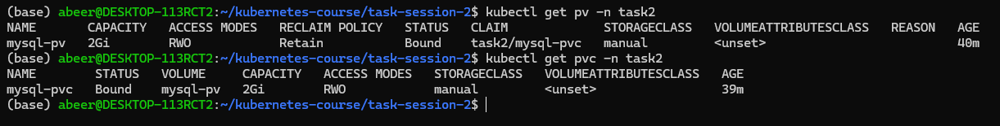
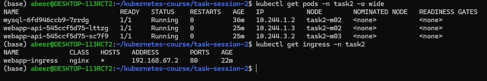
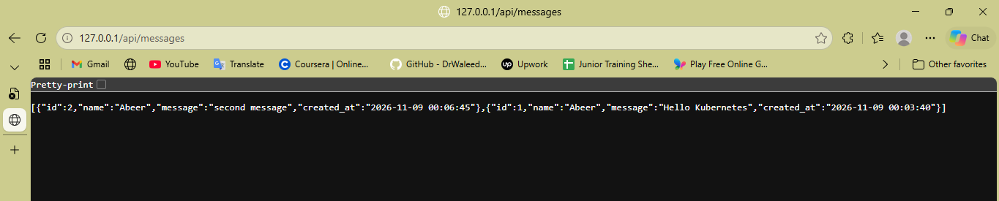
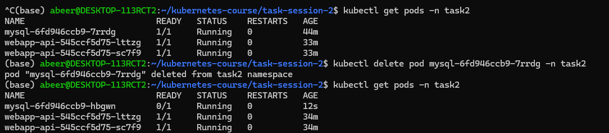
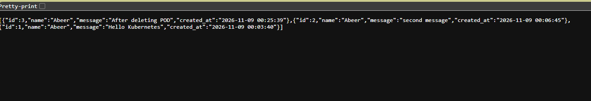

# **Task 2 Screenshots**

### Let's breakdown all task process

1. PV/PVC bounded

2. Running PODs and ingress

3. API Running and see messages (before deleteing running POD)

4. Deleting mysql running pod and see the replacement

5. Runing API after deleting (data persistence after Pod restart)

### You can find all the files inside /manifests folder
